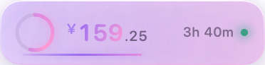
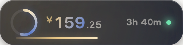
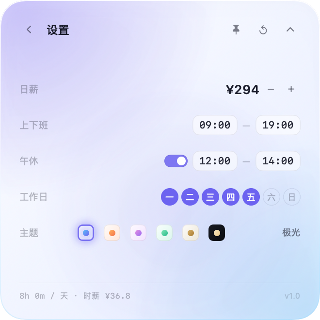

# 薪跳 · Wagebeat

> 一枚会跳动的工资条。把「今天赚了多少」变成桌面上一件安静的小饰品。

macOS 桌面悬浮计时工具。不开窗口、不占 Dock，只在右上角留一条窄窄的光带；
点开是正方形面板，随时告诉你今天赚到哪儿了、离下班还有多久。


---

## 一眼看到的样子

收起态是一条 186×46 的细长浮窗，只有进度环、金额、剩余时间：


点开后是 330×330 的正方卡片，今日、本月、时薪、每秒收入全在里面：


---

## 六套主题，随手切

默认浅色。左上主题亮色柔光 + 右下副色柔光叠在柔和渐变上，所以每一套都有点「炫彩」的意思，但不刺眼。

| 极光 Aurora | 蜜桃 Peach | 香芋 Lilac |
| :---: | :---: | :---: |
|  |  |  |
| **薄荷 Mint** | **珍珠 Pearl** | **曜石 Ink** |
|  |  |  |

设置页里一排小色块就是主题切换器，每个色块都是对应主题的迷你缩略图：



> 切主题是即时生效的，不重启、不重开面板。

---

## 它会算些什么

按你的真实作息算，而不是拿日薪除以 24 小时糊弄人。

- **日薪**：比如 294 元
- **上下班**：09:00 — 19:00
- **午休**：12:00 — 14:00（午休不計薪，可整体关掉）
- **工作日**：周一到周五，可逐天开关

于是今天只计薪 8 小时，`每秒 = 294 ÷ (8×3600) ≈ ¥0.010`。
金额每 0.1 秒刷新一次，数字自己在跳。

面板上还会顺带给你：

| 指标 | 说明 |
| --- | --- |
| 今日已入账 | 此刻已经赚到的钱，精确到分 |
| 进度 | 今日进度百分比 + 金额 / 目标 |
| 剩余 | 距打卡下班还有多久 |
| 时薪 / 每秒 | 让你对「这一小时值多少钱」有实感 |
| 本月累计 | 本月已赚 / 本月应得，按实际工作日推算 |
| 距下班 | 和「剩余」同源，换个角度提醒你 |

金额跨过每 10 元时会轻轻飘一行 `+ ¥10`，不打扰，但看得见。

---

## 阶段与文案

同一天里，它会知道自己在哪个阶段，并换一句话：

| 阶段 | 文案示例 |
| --- | --- |
| 待开工 | 距离开工还有 1 小时 20 分，先把自己照顾好。 |
| 计薪中 | 过半了。下午的每一分钟都是净收益。 |
| 午休中 | 午休是带薪的，5 小时 20 分之后自由。 |
| 已收工 | 今天 ¥294 已落袋。剩下的时间，属于你自己。 |
| 休息日 | 今天不上班。不被打扰的时间，也是收入的一部分。 |

---

## 窗口行为

- **始终置顶** — 默认浮在所有窗口之上，可在菜单栏或设置里关掉
- **拖动即定位** — 按住面板任意位置拖动，松手记住位置，下次启动原样回来
- **右上角锚点展开** — 展开/收起时贴住右上角缩放，不会突然跳走
- **跨 Space 悬浮** — 切桌面、进全屏应用，它都还在
- **无 Dock 图标** — `LSUIElement`，只活在屏幕和菜单栏里
- **菜单栏入口** — 展开/收起、显示/隐藏、始终置顶、偏好设置、退出

快捷键：`⌘,` 打开设置，`⌘Q` 退出。

---

## 安装

### 下载

到 [Releases](../../releases) 下载最新的 `Wagebeat.app.zip`，解压后拖进「应用程序」。

首次打开若被 Gatekeeper 拦下，右键 → 打开，或执行：

```bash
xattr -dr com.apple.quarantine /Applications/Wagebeat.app
```

### 自己编译

需要 macOS 13+ 与 Swift 5.9+（Xcode 15 或 Command Line Tools）。

```bash
git clone https://github.com/Shamnick/Wagebeat.git
cd Wagebeat
./Scripts/build-app.sh release
open build/Wagebeat.app
```

只跑源码不打包也可以：

```bash
swift run Wagebeat
```

---

## 项目结构

```
Sources/Wagebeat/
├── App/
│   ├── WagebeatApp.swift      # @main + AppDelegate，装配面板与菜单栏
│   ├── PanelController.swift  # NSPanel 悬浮、拖拽、展开动画、位置记忆
│   ├── AppModel.swift         # 0.1s 心跳、里程碑提示
│   └── PreviewRenderer.swift  # 离屏渲染各状态，产出 README 配图
├── Model/
│   ├── SalaryEngine.swift     # 纯函数：给定时间 → 薪资快照
│   └── WorkSettings.swift     # 计薪规则 + UserDefaults 持久化
├── Support/
│   ├── Theme.swift            # 6 套 Palette 与尺寸常量
│   └── Format.swift           # 金额、时长、百分比格式化
└── Views/
    ├── RootView.swift         # 收起/展开切换
    ├── CompactView.swift      # 186×46 长条
    ├── ExpandedView.swift     # 330×330 正方卡片
    ├── SettingsView.swift     # 设置页与主题切换器
    └── Components.swift       # 卡片底、进度环、进度条、金额主展示
```

计薪逻辑是纯函数：`SalaryEngine.snapshot(settings, at: date)` 输入规则与时刻，输出一个不可变的 `SalarySnapshot`，视图只读不算。所以任何时间点都能离线渲染、能被测试、也不会因为界面刷新而漂移。

---

## 设计上的几个小决定

**为什么用「距零点的分钟数」存时间？**
时分秒换成整数分钟后，跨天、夏令时、时区这些麻烦事就消失了。午休只是把一整段挖掉，剩下两段 `paidSegments` 累加即可。

**为什么收起态那么窄？**
桌面工具最怕存在感过强。186×46 只够放一个环、一个数、一个时间，剩下的全在展开后。

**为什么柔光而不是纯色？**
纯色渐变看着干净但呆板。两团不同色相的径向柔光叠上去，加上一层极淡的主色在中下方过渡，卡片就有了「光在流动」的错觉——炫彩感是从光来的，不是从饱和度来的。

**为什么 0.1 秒刷新？**
1 秒太顿，0.01 秒浪费。0.1 秒足够让小数位看起来在呼吸。

---

## 路线图

- [x] 实时计薪引擎（含午休挖空、跨月统计）
- [x] 收起 / 展开双态面板
- [x] 始终置顶、拖拽定位、位置记忆、跨 Space
- [x] 菜单栏入口
- [x] 6 套浅色炫彩主题 + 深色，即时切换
- [x] 里程碑飘字
- [ ] 加班时段单独计价
- [ ] 多份工作 / 多时段规则
- [ ] 历史收入曲线

---

## 许可

[MIT](LICENSE)

如果它让你每天早上多点开一次、下班前多看一眼，那就值得一个 Star。
