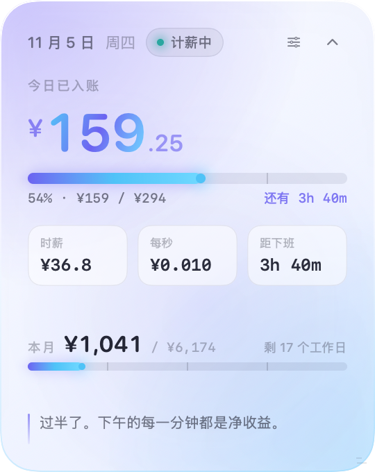
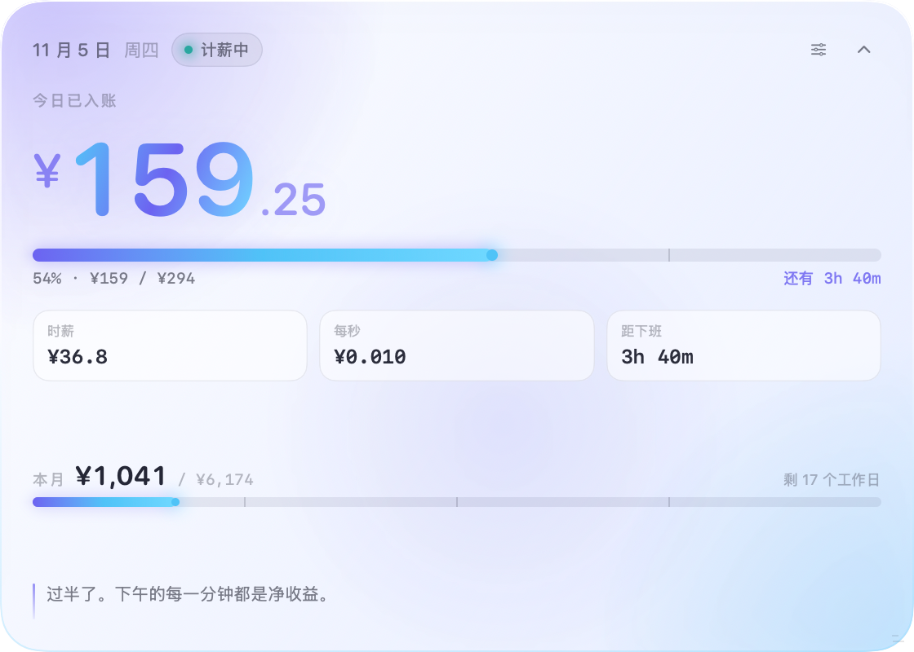

<div align="center">

# 薪跳 · Wagebeat

**一枚会跳动的工资条。**

把「今天赚了多少」变成桌面上一件安静的小饰品。

[](https://github.com/Shamnick/Wagebeat/releases/latest)
[](https://github.com/Shamnick/Wagebeat/stargazers)


</div>

---

## 它长什么样

平时是一条窄窄的光带，安静趴在屏幕角落。**不占 Dock，不抢焦点，不打断你。**


点开，是一块能自定尺寸的小仪表盘 —— 今日已入账、本月累计、时薪、每秒收入，全在里面。


---

## 为什么要用它

工资是月结的，但人生是按分钟过的。

大多数人一年只在发薪日那天看一眼数字，其余 250 天都在"上班"这件模糊的事里漂着。薪跳把这段时间切开、摊平、变成一条持续增长的线 —— 你在打字、在开会、在发呆，右上角那个数字一直在走。

不是为了催你干活，是为了让你**看得见自己已经赚到了什么**。

> 下午三点，你已经赚了 159 元。这个数字比任何一句「加油」都具体。

---

## 核心功能

### 按真实作息算，不糊弄

日薪 294 元，09:00 上班，12:00–14:00 午休，19:00 下班 —— 它知道午休不计薪，所以只算 8 小时：

```
每秒 = 294 ÷ (8 × 3600) ≈ ¥0.010
```

金额每 **0.1 秒**刷新一次，小数位自己在呼吸。跨过每 10 元会轻轻飘一行 `+ ¥10`，不打扰，但看得见。

### 自由拉伸，大小随你

卡片右下角有个小斜线手柄，想多宽就多宽、想多高就多高：

- **收起态**：只能横向拉（160 → 460pt），宽度不够时自动收起次要信息
- **展开态**：宽高双向拉（270–560 × 340–400pt），主金额会跟着一起长大
- 拉宽之后收起态会自动换成本月累计，不留大片空白
- 松手即记住，下次启动还是这个尺寸；菜单栏里一键「恢复默认尺寸」

<div align="center">
&nbsp;
&nbsp;

</div>

<div align="center"><sub>同一条浮窗的三个宽度：极窄只看钱 · 默认 · 拉宽后显示本月累计</sub></div>

<br>

<div align="center">
&nbsp;&nbsp;

</div>

<div align="center"><sub>展开态也能拉 —— 最小 270×340，最大 560×400</sub></div>

### 六套主题，随手切

默认浅色。左上主题亮光 + 右下副色柔光叠在渐变上，所以每一套都有点「炫彩」的意思，但不刺眼。

| 极光 Aurora | 蜜桃 Peach | 香芋 Lilac |
| :---: | :---: | :---: |
|  |  |  |
| **薄荷 Mint** | **珍珠 Pearl** | **曜石 Ink** |
|  |  |  |

设置页里那一排色块就是主题切换器，每个都是对应主题的迷你缩略图。点了立刻变，不重启、不重开面板。


### 它知道现在是几点

同一天里，它会认出自己处在哪个阶段，并换一句人话：

| 阶段 | 它说的话 |
| --- | --- |
| 待开工 | 距离开工还有 1 小时 20 分，先把自己照顾好。 |
| 计薪中 | 过半了。下午的每一分钟都是净收益。 |
| 午休中 | 午休是带薪的，5 小时 20 分之后自由。 |
| 已收工 | 今天 ¥294 已落袋。剩下的时间，属于你自己。 |
| 休息日 | 今天不上班。不被打扰的时间，也是收入的一部分。 |

### 桌面礼仪

- **始终置顶** — 默认浮在所有窗口之上，可一键关掉
- **拖动即定位** — 按住面板任意位置拖动，松手记住坐标，换显示器也不会跑丢
- **右上角锚点** — 展开 / 收起 / 拉伸都贴着右上角走，不会突然跳走
- **跨 Space 悬浮** — 切桌面、进全屏应用，它都还在
- **无 Dock 图标** — `LSUIElement`，只活在屏幕和菜单栏里

菜单栏图标里有：展开 / 收起、显示 / 隐藏、恢复默认尺寸、始终置顶、偏好设置、退出。

---

## 安装

### 下载（推荐）

1. 点右上角 **[Releases](https://github.com/Shamnick/Wagebeat/releases/latest)**
2. 下载 `Wagebeat.app.zip`
3. 解压，把 `Wagebeat.app` 拖进「应用程序」
4. 双击打开

> 这是个没上架的独立小工具，首次打开若被 Gatekeeper 拦下：**右键 → 打开**，或执行
> ```bash
> xattr -dr com.apple.quarantine /Applications/Wagebeat.app
> ```

### 自己编译

需要 macOS 13+ 与 Swift 5.9+（Xcode 15 或 Command Line Tools）。

```bash
git clone https://github.com/Shamnick/Wagebeat.git
cd Wagebeat
./Scripts/build-app.sh release
open build/Wagebeat.app
```

只跑源码不打包：

```bash
swift run Wagebeat
```

想自己出截图（会渲染 6 套主题 × 3 种状态）：

```bash
swift run Wagebeat --render ./shots
```

---

## 项目结构

```
Sources/Wagebeat/
├── App/
│   ├── WagebeatApp.swift      # @main + AppDelegate，装配面板与菜单栏
│   ├── PanelController.swift  # NSPanel 悬浮、拖动、缩放手柄、位置记忆
│   ├── AppModel.swift         # 0.1s 心跳、里程碑提示、卡片尺寸
│   └── PreviewRenderer.swift  # 离屏渲染各状态，产出 README 配图
├── Model/
│   ├── SalaryEngine.swift     # 纯函数：给定时间 → 薪资快照
│   └── WorkSettings.swift     # 计薪规则 + 尺寸 + UserDefaults 持久化
├── Support/
│   ├── Theme.swift            # 6 套 Palette 与尺寸常量
│   └── Format.swift           # 金额、时长、百分比格式化
└── Views/
    ├── RootView.swift         # 收起/展开切换，尺寸透传
    ├── CompactView.swift      # 长条浮窗，宽度自适应
    ├── ExpandedView.swift     # 正方仪表盘，主金额随尺寸缩放
    ├── SettingsView.swift     # 设置页与主题切换器
    └── Components.swift       # 卡片底、进度环、进度条、缩放手柄
```

计薪逻辑是纯函数：`SalaryEngine.snapshot(settings, at: date)` 输入规则与时刻，输出一个不可变的 `SalarySnapshot`，视图只读不算。所以任何时间点都能离线渲染、能被测试、也不会因为界面刷新而漂移。

---

## 几个设计决定

**为什么用「距零点的分钟数」存时间？**
时分秒换成整数分钟后，跨天、夏令时、时区这些麻烦事就消失了。午休只是把一整段挖掉，剩下两段 `paidSegments` 累加即可。

**为什么收起态那么窄？**
桌面工具最怕存在感过强。186×46 只够放一个环、一个数、一个时间，剩下的全在展开后。想多看一点，那就把它拉宽 —— 但默认不该占地方。

**为什么柔光而不是纯色？**
纯色渐变看着干净但呆板。两团不同色相的径向柔光叠上去，加上一层极淡的主色在中下方过渡，卡片就有了「光在流动」的错觉 —— 炫彩感是从光来的，不是从饱和度来的。

**为什么窗口不带系统阴影？**
`NSPanel` 的默认阴影会沿着圆角描出一条灰黑色的边，很脏。现在关掉 `hasShadow`，窗口四周留 20pt 透明留白，卡片自己画投影 —— 边缘是干净的。

**为什么 0.1 秒刷新？**
1 秒太顿，0.01 秒浪费。0.1 秒足够让小数位看起来在呼吸。

---

## 路线图

- [x] 实时计薪引擎（含午休挖空、跨月统计）
- [x] 收起 / 展开双态面板
- [x] 始终置顶、拖拽定位、位置记忆、跨 Space
- [x] 菜单栏入口
- [x] 6 套浅色炫彩主题 + 深色，即时切换
- [x] 里程碑飘字
- [x] **自由拉伸尺寸，松手即记**
- [ ] 加班时段单独计价
- [ ] 多份工作 / 多时段规则
- [ ] 历史收入曲线
- [ ] 通知中心小组件

---

## 许可

[MIT](LICENSE)

<div align="center">

<br>

如果它让你每天早上多点开一次、下班前多看一眼 ——

**那就值得一个 Star。**

[](https://github.com/Shamnick/Wagebeat/stargazers)

</div>
